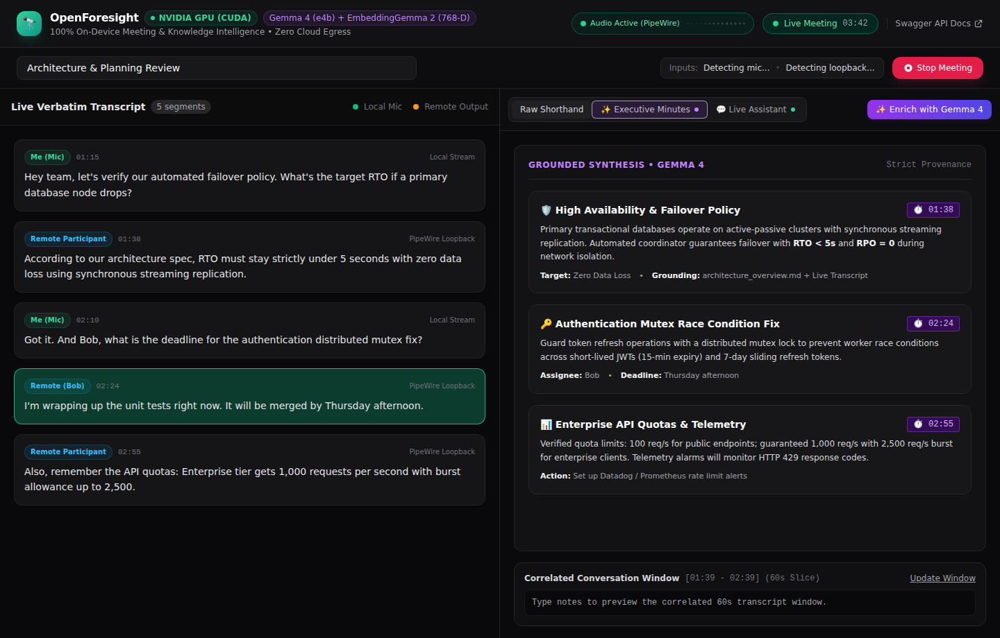

# 🔭 OpenForesight

**100% On-Device Meeting & Knowledge Intelligence for Linux**  
*An open-source Linux reimplementation and simulation of [Google AI Edge Foresight for macOS](https://blog.google/technology/developers/embeddinggemma-2/), powered by NVIDIA GPUs, PipeWire, Whisper, and Google Gemma models.*

[-FCC624?logo=linux&logoColor=black)]()
[-76B900?logo=nvidia)]()
[]()
[]()
[]()
[]()

<br>

<p align="center">
  
</p>

---

## 🌟 Overview

> **About this Project:**  
> In Google's announcement of [EmbeddingGemma 2: an open, lightweight multimodal embedding model](https://blog.google/technology/developers/embeddinggemma-2/), the Google AI Edge team unveiled **Google AI Edge Foresight**—an experimental on-device meeting assistant and ambient knowledge companion built exclusively for **macOS on Apple Silicon**.  
>  
> **OpenForesight** is an independent, 100% open-source simulation and recreation of that breakthrough workflow for the **Linux & NVIDIA** ecosystem. It re-engineers Google's vision from the ground up: substituting macOS audio taps with Linux **PipeWire loopback monitors**, and running the official **`gemma4:e4b`** and **`embeddinggemma-2`** models locally on NVIDIA CUDA hardware via Ollama.

Unlike traditional cloud-dependent SaaS meeting assistants (e.g., Otter.ai, Granola, Fireflies, Zoom AI Companion), OpenForesight executes **100% of speech recognition, temporal note synchronization, document indexing, and generative synthesis locally**:

* 🔒 **Zero Cloud Egress:** All audio streams, transcripts, notes, and local documents remain strictly on your machine (`localhost`).
* 🖥️ **Linux Native Audio Plumbing:** Uses **PipeWire** to record both local microphone input and remote meeting participant audio (via desktop audio loopback/monitor sinks) directly.
* ⚡ **NVIDIA GPU Acceleration:** Runs fast streaming ASR and LLM synthesis locally on any modern NVIDIA GPU (e.g. GeForce RTX 3080/3090/4080/4090, RTX 6000 Ada, NVIDIA Spark / Grace Blackwell GB10, or workstation cards).
* ⏱️ **Temporal Keystroke Synchronization:** Anchors hurriedly typed shorthand bullets to the exact conversational window ($[T_{\text{note}} - 45\text{s}, T_{\text{note}} + 15\text{s}]$) to synthesize hallucination-free executive meeting minutes with verifiable timestamp citations (`[ref: MM:SS]`).
* 📚 **Multimodal Document RAG:** Automatically indexes PDFs, Markdown, and technical specifications into 768-D dense vectors via Google's **EmbeddingGemma 2**, enabling real-time Q&A grounded in both meeting transcripts and your personal knowledge base.

---

## 🏛️ System Architecture

```text
┌────────────────────────────────────────────────────────────────────────────────────────┐
│                                APPLICATION FRONTEND                                    │
│   Web Studio UI (HTML5 + Tailwind CSS + WebSockets + Markdown Renderer)                │
│   - Split-Screen Studio:                                                               │
│     * Left Pane: Live Verbatim Streaming Transcript with Speaker & Channel Badges      │
│     * Right Pane: Raw Shorthand Editor ↔ ✨ Executive Minutes ↔ 💬 Live Assistant RAG   │
└───────────────────────────────────────────┬────────────────────────────────────────────┘
                                            │ WebSockets & REST APIs (Port 8000)
┌───────────────────────────────────────────▼────────────────────────────────────────────┐
│                              FASTAPI BACKEND DAEMON                                    │
│                                                                                        │
│   [ PipeWire Monitor Tap (Loopback) ]        [ Microphone Source Tap ]                 │
│                 │                                        │                             │
│                 └────────────────► [ Silero VAD ] ◄──────┘                             │
│                                           │ Speech Bursts                              │
│                                           ▼                                            │
│                         [ Whisper ASR on NVIDIA GPU (CUDA) ]                           │
│                                           │ Word-Level Timestamps                      │
│                                           ▼                                            │
│                       [ SQLite WAL Database (foresight.db) ]                           │
│                                           │                                            │
│              ┌────────────────────────────┴────────────────────────────┐               │
│              ▼                                                         ▼               │
│   [ Temporal Note Aligner ]                                [ Local Knowledge RAG ]     │
│   [T_note - 45s, T_note + 15s]                             (768-D EmbeddingGemma 2)    │
│              └────────────────────────────┬────────────────────────────┘               │
│                                           ▼                                            │
│                         [ Grounded Synthesis with Gemma 4 ]                            │
└────────────────────────────────────────────────────────────────────────────────────────┘
```

---

## 💻 Hardware & Software Requirements

| Requirement | Details |
| :--- | :--- |
| **Operating System** | Any modern Linux distribution (Ubuntu 22.04+, Debian 12+, Fedora 38+, Arch Linux) |
| **Architecture** | **x86_64** (Intel/AMD) or **aarch64** (ARM64, NVIDIA Grace / Jetson / Spark) |
| **GPU Compute** | NVIDIA GPU with CUDA support (RTX 3060/3080/4080/4090, A-Series, GB10, etc.) |
| **Audio Server** | PipeWire with `pw-record` / `pw-cli` installed |
| **Python** | Python 3.12+ (recommended with [`uv`](https://github.com/astral-sh/uv)) |
| **Local LLM Engine** | [Ollama](https://ollama.com/) running on `localhost:11434` |

---

## 🚀 Quickstart & Installation

### 1. Clone & Set Up Python Environment

Using `uv` (recommended for fast installation):
```bash
git clone https://github.com/your-username/open-foresight.git
cd open-foresight

# Create virtual environment and install dependencies
uv sync
```

Or using standard `pip`:
```bash
python3 -m venv .venv
source .venv/bin/activate
pip install -e .
```

### 2. Install & Start Local Models with Ollama

OpenForesight uses the official models highlighted by Google AI Edge Foresight:
```bash
# Pull Gemma 4 for grounded note enrichment and assistant synthesis
ollama pull gemma4:e4b

# Pull EmbeddingGemma 2 for 768-dimensional dense vector embeddings
ollama pull embeddinggemma-2
```

Ensure Ollama is running (`curl http://localhost:11434/api/tags` returns your models).

---

## 🛠️ Usage

### 1. Unified Command-Line Interface (`open-foresight`)

OpenForesight includes a unified CLI dispatcher:

```bash
# Launch the backend daemon and ambient Web Studio UI
open-foresight serve

# Run the interactive live terminal capture demo
open-foresight demo

# Batch index markdown or PDF documentation into the vector store
open-foresight index [path/to/docs]
```

---

### 2. Interactive Terminal Live Demo
Test your microphone and desktop audio loopback immediately in the terminal:
```bash
.venv/bin/python run_live_demo.py
# or: open-foresight demo
```
This script will:
1. Scan and detect your PipeWire microphone and audio sink monitor.
2. Initialize Whisper on your NVIDIA GPU with CUDA.
3. Stream real-time transcripts directly to your terminal as you speak.
4. Commit timestamps and dialogue to SQLite.

---

### 3. Launching the Web Studio & Daemon

Start the FastAPI daemon:
```bash
.venv/bin/uvicorn daemon.app:app --host 0.0.0.0 --port 8000
# or: open-foresight serve
```

Now open your browser to **[http://localhost:8000](http://localhost:8000)**.

#### What you can do in the Web Studio:
1. **Live Meeting Mode:** Click **Start Meeting** to stream real-time transcripts with `[Me]` and `[Remote]` speaker badges. Includes a real-time PipeWire audio visualizer driven by server-side RMS telemetry (emerald for local microphone, amber for remote loopback) with zero browser permission prompts or ALSA/Pulse audio contention.
2. **Raw Shorthand Notes:** Type hurried bullet points in the center editor (e.g. `- auth race condition, bob by thurs`). Every keystroke is automatically timestamped.
3. **✨ Enrich with Gemma 4:** Click the enrich button to correlate your bullets with the conversation window and generate executive minutes with `[ref: MM:SS]` citations.
4. **💬 Live Assistant RAG:** Chat with the assistant to query your meeting transcript and local documents simultaneously, featuring dual-grounding across both active session dialogues, historical cross-session discussions, and indexed markdown/PDF specifications.

---

### 4. Indexing a Local Knowledge Base

You can index any folder of documents, specifications, or notes using the CLI tool:
```bash
# Index a specific folder of markdown or PDF documents:
open-foresight index /path/to/your/documents

# Or index your current working directory:
open-foresight index .
```

Documents placed in the `docs/` folder are also automatically indexed in the background by the daemon's autonomous file watcher.

---

## 🧪 Running the Verification Suite

Run the full pytest suite (15 automated tests):
```bash
PYTHONPATH=. .venv/bin/pytest tests/
```

### Test Coverage:
* `tests/test_api_endpoints.py`: REST endpoints, audio device discovery, and session lifecycle.
* `tests/test_asr_transcription.py`: GPU-accelerated Whisper ASR, Silero VAD, and SQLite persistence.
* `tests/test_db.py`: SQLite schema, WAL journal mode, and temporal window slicing.
* `tests/test_shorthand_engine.py`: Temporal window correlation and Gemma 4 synthesis.
* `tests/test_rag_pipeline.py`: Semantic chunking, 768-D vector store, and Live Assistant multi-source grounding.

---

## 📂 Repository Structure

```text
open-foresight/
│
├── daemon/                          # Python Backend Daemon (FastAPI + WebSockets)
│   ├── app.py                       # REST APIs and WebSocket server
│   ├── session_manager.py           # Live session pipeline coordinator
│   ├── audio/                       # Audio plumbing & capture
│   │   ├── capture.py               # PipeWire dual-stream capture (pw-record)
│   │   └── vad.py                   # Silero VAD speech segmenter
│   ├── asr/                         # Speech Recognition
│   │   ├── engine.py                # Whisper ASR on CUDA
│   │   └── timestamps.py            # Word-level timestamp utilities
│   ├── sync/                        # Shorthand Engine
│   │   └── enricher.py              # Temporal window note expansion with Gemma 4
│   ├── rag/                         # Local Knowledge RAG
│   │   ├── watcher.py               # Background folder watcher
│   │   ├── chunker.py               # PDF and Markdown semantic chunker
│   │   ├── vector_store.py          # SQLite 768-D vector store
│   │   ├── embeddings.py            # EmbeddingGemma 2 client (768-D)
│   │   └── assistant.py             # Multi-source Live Assistant
│   ├── llm/                         # Local LLM Client
│   │   └── client.py                # Gemma 4 Ollama client
│   ├── db/                          # Storage Layer
│   │   ├── schema.sql               # SQLite DDL schema
│   │   └── repository.py            # Async SQLite data access (PRAGMA foreign_keys = ON)
│   └── static/                      # Ambient Web Studio UI
│       ├── index.html               # Single-page meeting intelligence studio
│       └── vendor/                  # Bundled offline libraries (Tailwind, Marked, DOMPurify)
│
├── docs/                            # Watched knowledge directory (PDFs, Markdown)
│   └── architecture_overview.md     # Out-of-the-box knowledge document
│
├── tests/                           # Complete Verification Suite (15 tests)
│   ├── test_api_endpoints.py        # REST endpoint tests
│   ├── test_asr_transcription.py    # GPU ASR pipeline tests
│   ├── test_db.py                   # SQLite storage & window query tests
│   ├── test_shorthand_engine.py     # Gemma 4 & EmbeddingGemma 2 tests
│   └── test_rag_pipeline.py         # RAG chunker, vector store & assistant tests
│
├── index_workspace.py               # CLI tool to batch index any directory
├── run_live_demo.py                 # Interactive terminal live recording demo
├── GEMINI.md                        # Canonical architecture & engineering guide
├── pyproject.toml                   # Project configuration and dependencies
└── README.md                        # This documentation
```

---

## 🔒 Security, Privacy & Data Protection Invariants

1. **Zero Cloud Egress:** All models, embeddings, audio streams, databases, and frontend scripts remain strictly on `localhost`. Front-end assets (Tailwind, Marked, DOMPurify) are fully vendored and served locally—zero outbound CDN or cloud requests are permitted.
2. **Absolute Data Confidentiality & Integrity:**
   - **No Database Leaks:** Meeting databases (`foresight.db`), session histories, and vector store embeddings contain confidential discussion records and are strictly ignored by `.gitignore`. They are never staged or pushed to Git.
   - **Foreign Key & Cascade Integrity:** Enforces `PRAGMA foreign_keys = ON` on all SQLite connections to prevent orphaned document chunks or meeting records.
   - **No Audio Uploads:** Raw audio captures, microphone streams, loopback monitor buffers (`*.wav`, `*.pcm`), and speech chunks never leave local memory/disk and are strictly barred from source control.
   - **No Personal Data Commits:** All configuration files and scripts use dynamic relative paths, ensuring user home directories, corporate hostnames, and credentials remain private.
3. **Strict Provenance:** Generative outputs are constrained by prompt engineering and temporal windowing to cite exact timestamps `[ref: MM:SS]` in conversation audio.
4. **Memory Hygiene:** In-memory PCM audio buffers are freed after processing; only structured transcript segments are retained in the local SQLite database.

---

## 📄 License

Apache 2.0 or MIT License. Feel free to use, modify, and contribute!
